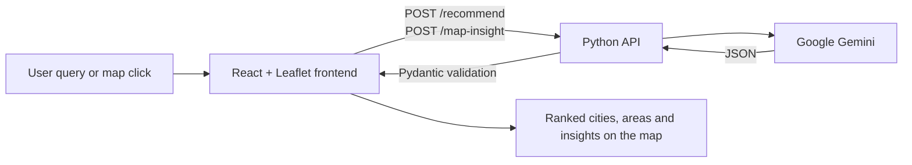

# Geo Market Match

**AI-assisted business location intelligence on an interactive map.**

Live demo: https://ai-based-business-startegy-app.vercel.app/

Geo Market Match helps someone answer a simple question: *where should I open this business?* You describe what you want in plain language ("a specialty coffee shop in the Gulf", "a gym in Islamabad"), and the app returns candidate cities and neighbourhoods on a map, each with a suitability score and a short explanation. You can also click anywhere on the map to get a street-level read of that exact spot for a chosen business type.

## How it works

1. **Natural language query.** The frontend sends your query to a small Python API.
2. **LLM reasoning with structured output.** The API prompts Google Gemini to extract the location and business intent from the query, then rank candidate cities and areas. The model is told to return strict JSON, which is validated against Pydantic schemas (`CityRecommendation`, `AreaInsight`, `LocationInsight`) before anything reaches the map.
3. **Map click analysis.** Clicking the map sends the coordinates and business type to a second endpoint. Gemini identifies the neighbourhood from the coordinates and returns opportunities, challenges, a 0.5 to 0.95 suitability score, estimated startup cost, revenue range and a target customer profile.
4. **Fallback mode.** If no API key is set, the backend returns built-in sample data so the interface still works for demos.



## Features

- Free text search for business location ideas, worldwide
- Ranked cities with drill down into specific areas, all plotted on the map
- Click anywhere for a location insight panel (opportunities, challenges, score, cost and revenue estimates)
- Dark and light mode, collapsible side panel, help panel

## Tech stack

| Part | Technology |
|---|---|
| Frontend | React (Vite), React Leaflet, Tailwind CSS, Axios |
| Backend | Python: FastAPI (`backend/main.py`), with a Flask version (`backend/flask_app.py`) used for hosting |
| AI | Google Gemini (`google-generativeai`), JSON output validated with Pydantic |
| Hosting | Frontend on Vercel, API on PythonAnywhere |

## Run it locally

You need Python 3.10+ and Node.js 18+, plus a free Gemini API key from [Google AI Studio](https://aistudio.google.com/app/apikey).

**Backend**

```bash
git clone https://github.com/Gull01/AI_BASED_BUSINESS_STARTEGY-App.git
cd AI_BASED_BUSINESS_STARTEGY-App/backend
python -m venv .venv
source .venv/bin/activate        # Windows: .venv\Scripts\activate
pip install -r requirements.txt
cp .env.example .env             # then put your key in GOOGLE_API_KEY
uvicorn main:app --reload --port 8000
```

**Frontend**

```bash
cd ../frontend
npm install
npm run dev
```

The frontend points to the hosted API in `frontend/src/api.js`. To use your local backend, change `API_URL` there to `http://localhost:8000`.

## Project structure

```text
frontend/     React app (map, control panel, ranking and insight panels)
backend/      FastAPI and Flask versions of the API, Gemini client, schemas, tests
api/          Lightweight serverless version of the API
vercel.json   Frontend build and deploy config
```

## Limitations

This is a decision support prototype, not a market study. Scores, rents, foot traffic and revenue figures are **estimates generated by the language model**, not values computed from real spatial datasets, so treat them as a starting point for research rather than as facts. A natural next step is to ground the model in real data (OpenStreetMap points of interest, population grids, competitor counts) through tool calls, so its answers are backed by measured inputs.

## Author

Gul Nawaz, GIS specialist and GeoAI researcher. [gulnawaz.dev](https://gulnawaz.dev)

## License

MIT
